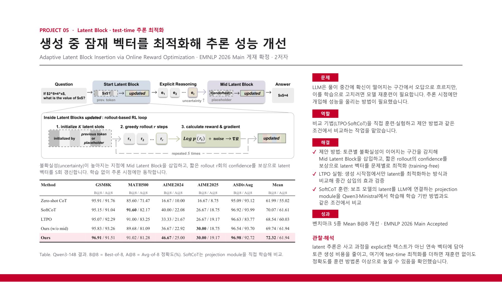

# Adaptive Latent Block Insertion

This research improves LLM reasoning during answer generation without retraining the model. I ran LTPO experiments and trained SoftCoT projection modules to compare these baselines with the proposed method.

[Back to portfolio](../README.md) · [Project PDF (Korean)](../assets/projects/adaptive-latent-block.pdf)

[Publication listing](https://dmis.korea.ac.kr/publications)

B@8 means Best-of-8; A@8 means Avg-of-8. The proposed method improves mean B@8 across the five benchmarks; individual benchmark metrics vary.

### Project problem, my baseline experiments, method, and results

