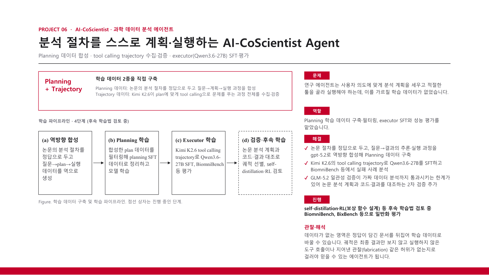

# AI-CoScientist

AI-CoScientist trains agents to plan scientific analyses and execute them with tools and code. I built and validated training data and fine-tuned the executor model.

[Back to portfolio](../README.md) · [Project PDF (Korean)](../assets/projects/ai-coscientist.pdf)

### Project problem, my data and executor training work, and ongoing pipeline

