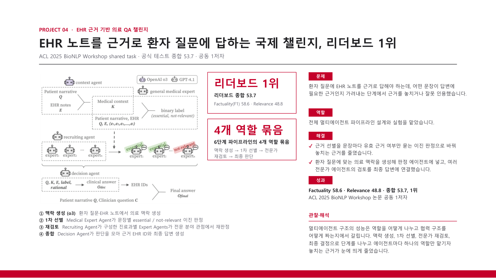

# ArchEHR-QA

ArchEHR-QA answers patient questions using evidence from electronic health records. I designed and tested the multi-agent pipeline for sentence-level evidence selection and specialist review.

[Back to portfolio](../README.md) · [Project PDF (Korean)](../assets/projects/archehr-qa.pdf)

[ACL Anthology](https://aclanthology.org/2025.bionlp-share.15/) · [Paper PDF](https://aclanthology.org/2025.bionlp-share.15.pdf)

The illustration summarizes four role groups within the paper's six-stage pipeline. Official test scores are Factuality 58.6, Relevance 48.8, and Overall 53.7.

### Project problem, my role, pipeline, and official results

