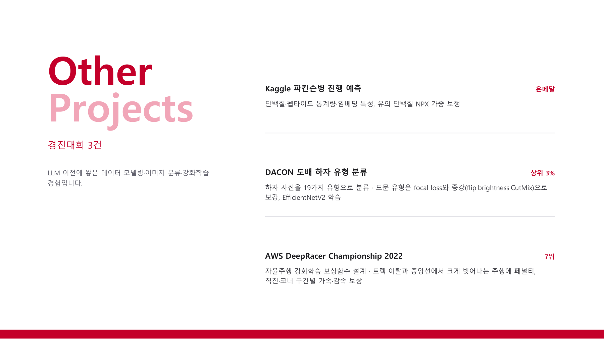

# Competition Projects

These competitions cover disease progression prediction, image classification, and autonomous racing. The portfolio page summarizes my feature engineering, model training, and reinforcement-learning reward design.

[Back to portfolio](../README.md) · [Project PDF (Korean)](../assets/projects/competition-projects.pdf)

### Parkinson's disease progression prediction, wallpaper defect classification, and AWS DeepRacer

