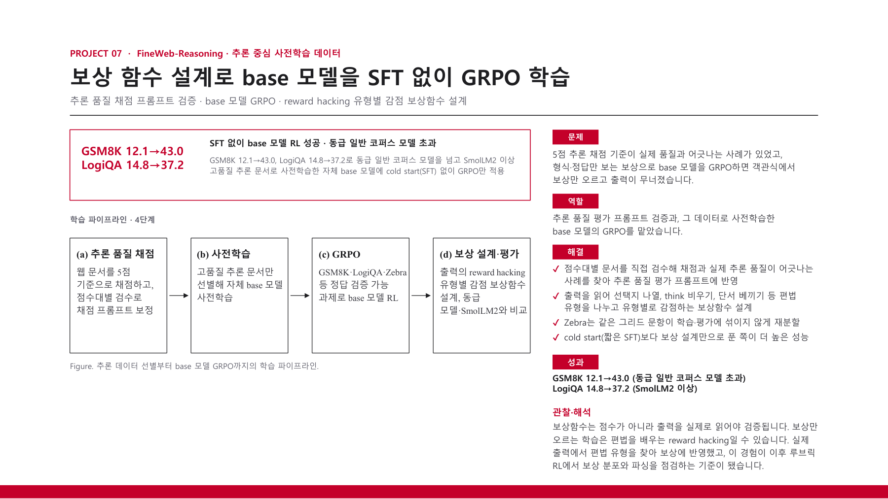

# FineWeb-Reasoning

FineWeb-Reasoning studies language-model training with reasoning-rich web documents. I validated document-scoring prompts, designed rewards against shortcuts, and trained the pretrained base model with GRPO without an initial SFT stage.

[Back to portfolio](../README.md) · [Project PDF (Korean)](../assets/projects/fineweb-reasoning.pdf)

### Project problem, my scoring and reward-design work, and results

