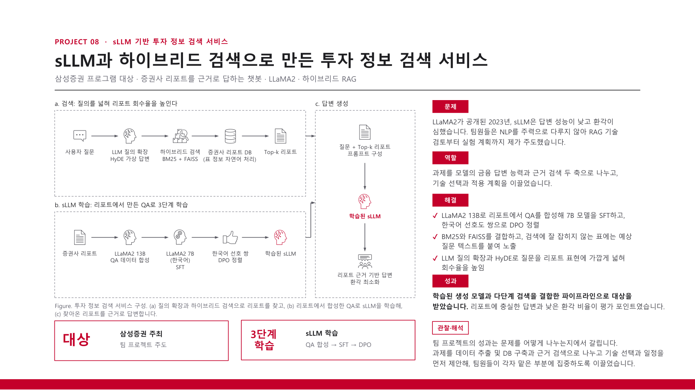

# sLLM Investment Information Retrieval

This chatbot answers investment questions using evidence from securities reports. I led the team, built the report database, and designed hybrid retrieval; the project won the Samsung Securities program grand prize.

[Back to portfolio](../README.md) · [Project PDF (Korean)](../assets/projects/investment-information-retrieval.pdf)

### Project problem, my retrieval contributions, team pipeline, and award

