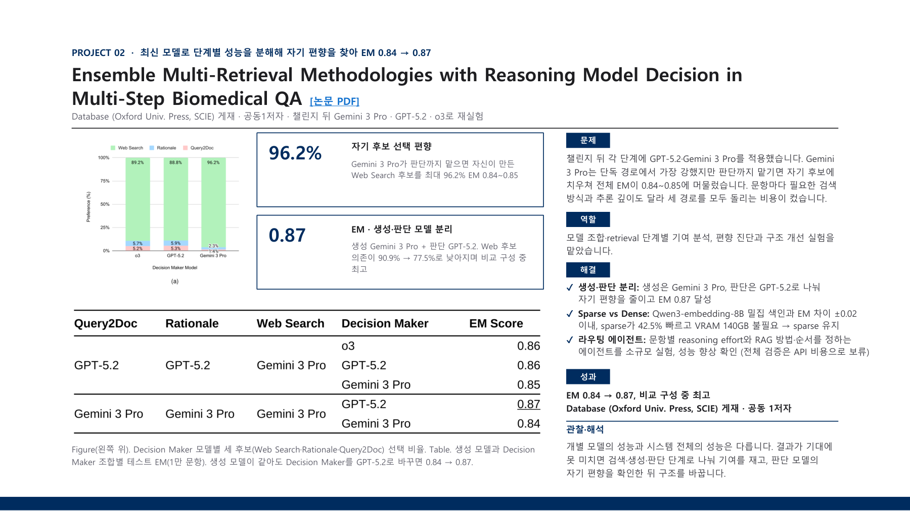

# MedHopQA Journal Extension

This research extends MedHopQA by studying how retrieval, answer generation, and final answer selection affect accuracy. I compared model combinations and retrieval methods, diagnosed the decision model's bias toward its own answers, and tested separate generation and decision models.

[Back to portfolio](../README.md) · [Project PDF (Korean)](../assets/projects/medhopqa-journal.pdf)

[Journal article](https://doi.org/10.1093/database/baag061) · [Challenge system](medhopqa.md)

EM 0.87 is a post-challenge test result with an updated model configuration. The routing experiment was exploratory; full validation remains pending.

### Component analysis, my contribution, and decision-model bias

