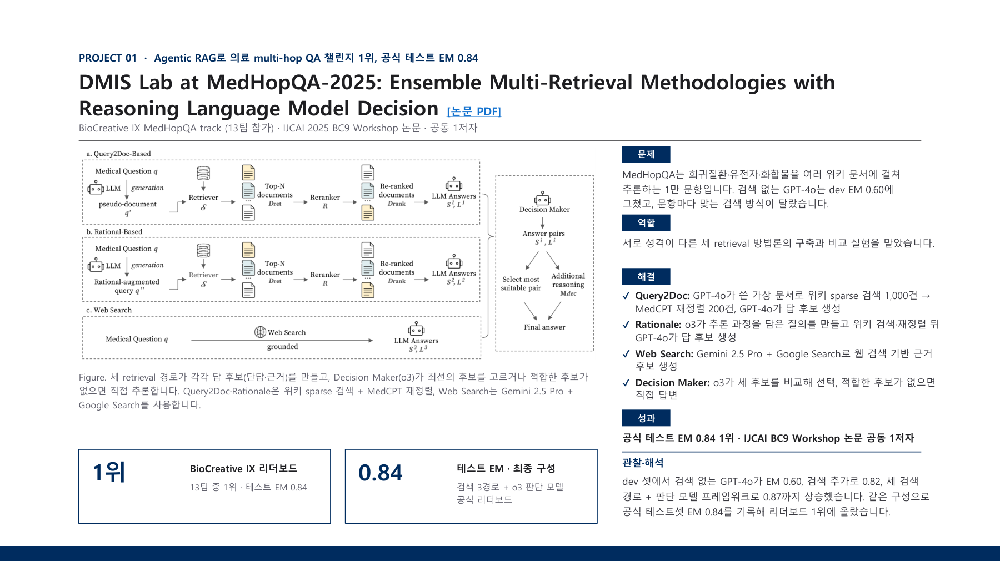

# MedHopQA Challenge

MedHopQA answers biomedical questions by combining evidence from multiple documents. I built and compared three retrieval methods for the challenge system, which placed first in BioCreative IX with an official test EM of 0.84.

[Back to portfolio](../README.md) · [Project PDF (Korean)](../assets/projects/medhopqa.pdf)

[Workshop proceedings](https://zenodo.org/records/16875348) · [Journal extension](medhopqa-journal.md)

The official challenge test EM is 0.84; the 0.87 shown for this configuration is a development-set result.

### Challenge system and my retrieval contributions

