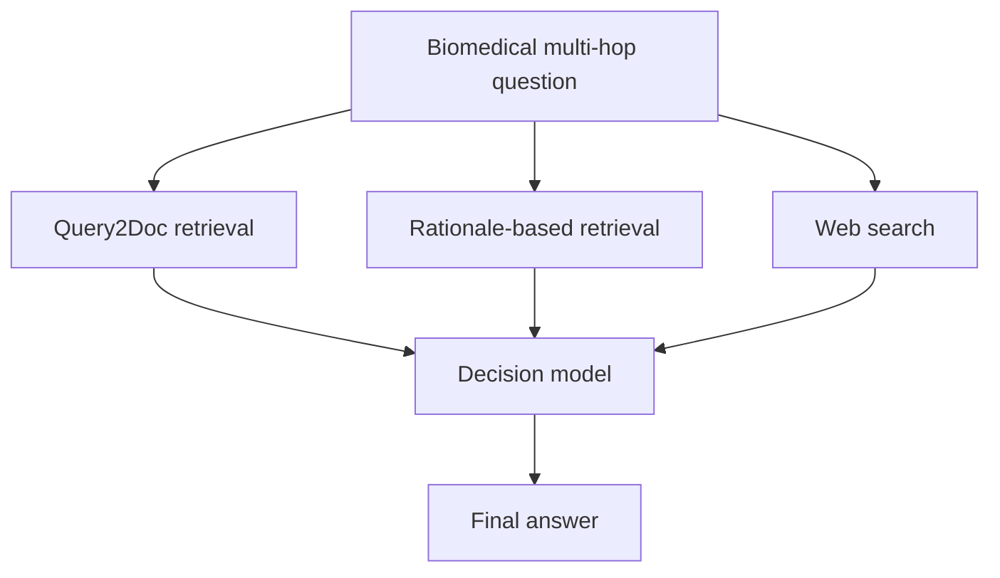

# MedHopQA

MedHopQA requires answering biomedical questions by combining evidence from multiple documents. Our system uses three retrieval methods to generate candidate answers, then a decision model selects or derives the final answer.

**My role:** Implementation and comparison of the three retrieval methods, analysis of decision-model bias in the journal extension. Co-first author of both papers.

[Back to portfolio](../README.md) · [Portfolio PDF (Korean)](../portfolio.pdf)

## Retrieval methods

| Method | Approach |
| --- | --- |
| Query2Doc | Generate a hypothetical document, run sparse retrieval, and rerank with MedCPT |
| Rationale-based retrieval | Generate queries from a reasoning process, then retrieve and rerank evidence |
| Web search | Collect evidence and candidate answers from the web |

The Query2Doc path retrieves 1,000 candidates with Elasticsearch and reranks 200 with MedCPT. The decision model compares the short answers and evidence from all three methods, then selects a candidate or reasons to a new answer.

## Results

| Experiment | Evaluation | Result |
| --- | --- | --- |
| BioCreative IX MedHopQA challenge | Official test evaluation | EM 0.84, first place |
| Journal extension | Internal evaluation | EM 0.87 |

EM stands for exact match.

In the journal extension, I compared the contributions of retrieval, generation, and final answer selection. Some decision models strongly preferred answers they had generated themselves. With the generation model fixed, replacing the decision model increased EM from 0.84 to 0.87 under our internal evaluation setup.

I also designed a routing agent that selects the reasoning effort, retrieval methods, and their order for each question. Small-scale experiments showed an improvement; full evaluation was deferred due to API cost.

The workshop submission and journal experiments used different model configurations and evaluation setups. The journal score is reported separately from the official challenge result.

## Papers and task

- [BioCreative IX workshop and paper list](https://www.ncbi.nlm.nih.gov/research/bionlp/biocreative9)
- [Workshop proceedings](https://zenodo.org/records/16875348)
- [MedHopQA task](https://www.ncbi.nlm.nih.gov/research/bionlp/medhopqa)

The workshop paper appeared at IJCAI 2025 BioCreative IX. The journal extension has been accepted by Database, Oxford University Press. Full titles are listed in [Publications](../PUBLICATIONS.md).

**Tools:** Python, Elasticsearch, sparse retrieval, MedCPT, Query2Doc, multi-agent QA.
