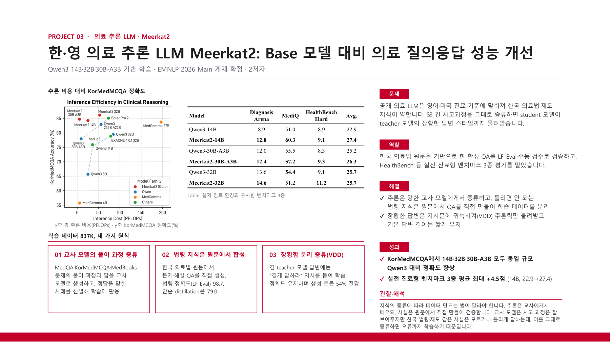
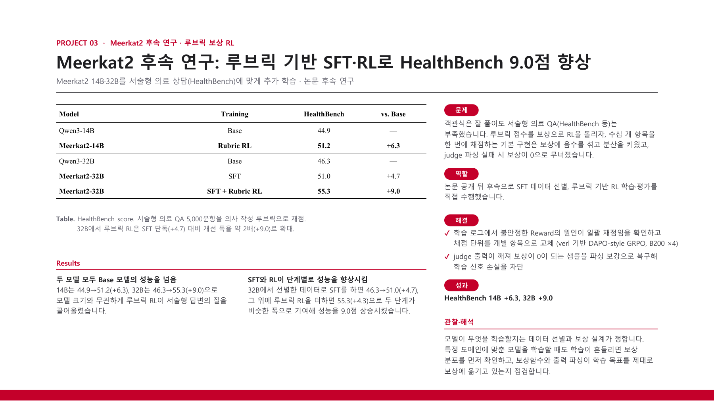

# Meerkat2 and Follow-up Training

Meerkat2 is a Korean-English medical reasoning model with knowledge of Korean medical laws. I validated legal QA and evaluated clinical benchmarks; in follow-up work, I selected SFT data and improved rubric-based reinforcement learning.

[Back to portfolio](../README.md) · [Project PDF (Korean)](../assets/projects/meerkat2.pdf)

[Publication listing](https://dmis.korea.ac.kr/publications)

The second page covers follow-up research. Its HealthBench improvements are measured against the Qwen3 baselines, separately from the original paper's HealthBench Hard evaluation.

### Original Meerkat2 research and my contribution

### Follow-up SFT and rubric-based RL

