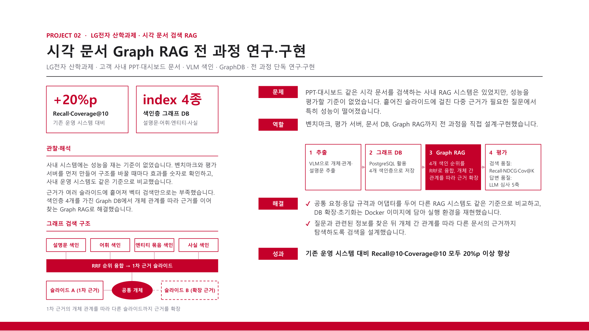
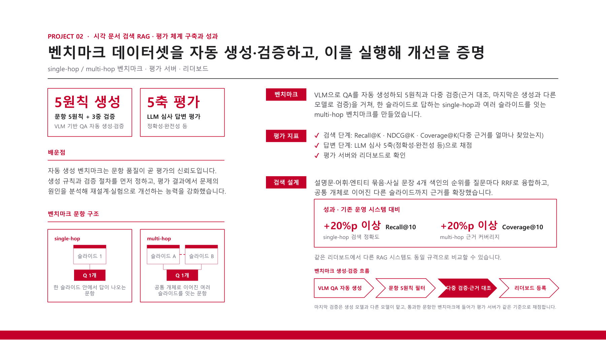

# Visual Document Graph RAG

This LG Electronics research collaboration retrieves evidence across company slides and dashboards. I designed and implemented the document database, Graph RAG system, benchmark, and evaluation server.

[Back to portfolio](../README.md) · [Project PDF (Korean)](../assets/projects/visual-document-rag.pdf)

### Project problem, my role, and retrieval architecture

### Benchmark design and evaluation results

