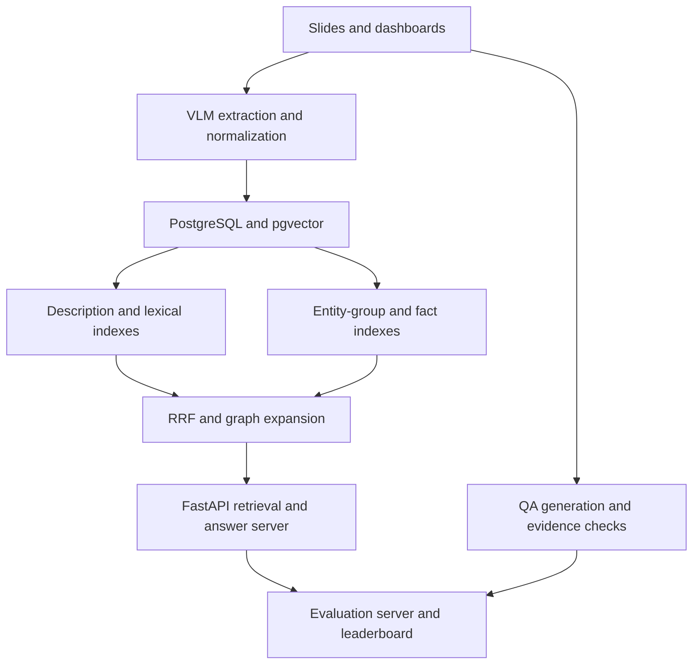

# Visual Document Graph RAG

I built a retrieval system that converts slides and dashboards into searchable data, along with a benchmark and evaluation server. This work was part of a research collaboration with LG Electronics.

**My role:** Research and implementation of the benchmark, database, Graph RAG pipeline, retrieval and answer server, and evaluation server.

[Back to portfolio](../README.md) · [Portfolio PDF (Korean)](../portfolio.pdf)

## Retrieval pipeline

The existing system could search visual documents, but there was no common benchmark for comparing changes. Questions requiring evidence from several slides also needed more than vector retrieval alone.

I used a vision-language model to extract entities, relationships, and descriptions from each slide, then normalized their representations. PostgreSQL stores document metadata, content, entities, and relationships. pgvector supports vector search.

Four indexes cover descriptions, lexical terms, entity groups, and factual sentences. Reciprocal rank fusion combines their rankings. The system then follows entity relationships from the retrieved slides to find evidence in other documents.

## Benchmark and evaluation

- Generated single-hop and multi-hop questions with a vision-language model, using five question-writing rules and multiple evidence checks.
- Verified that multi-hop questions required evidence from several slides.
- Evaluated retrieval with Recall@K, NDCG@K, and Coverage@K. Scored answers with an LLM judge on five criteria, including correctness and completeness.
- Defined common request and response formats and added adapters so different RAG systems could use the same evaluation server.
- Included database extensions and initialization settings in Docker images to reproduce the environment.

## Results

| Metric | Baseline | Improvement |
| --- | --- | --- |
| Single-hop Recall@10 | Existing internal system | More than 20 percentage points |
| Multi-hop Coverage@10 | Existing internal system | More than 20 percentage points |

Both systems were evaluated on the same benchmark. The improvements are absolute percentage-point differences.

**Tools:** Python, VLMs, PostgreSQL, pgvector, Graph RAG, RRF, FastAPI, Docker.
